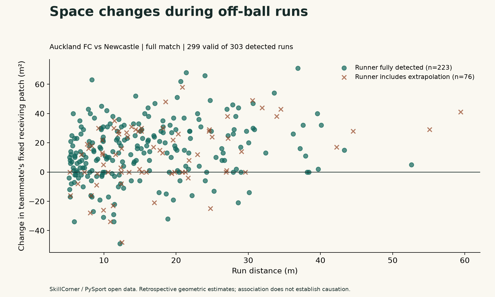

# Can we credit footballers who never touch the ball?

## A reproducible baseline, not causal credit

This analysis reconstructs high-speed attacking movement from SkillCorner's public broadcast tracking. It asks whether nearby defenders and a preselected teammate's receiving space changed during each run. A run can be measured without being awarded credit for causing the change.

## Scope and results

- Match: Auckland FC vs Newcastle, 2024-11-30; match ID 1886347.
- Scope: **full match**; valid tracking frames 10 to 59038; periods [1, 2].
- 303 runs pass the fixed baseline; median run distance 14.1 m.
- 223/303 runners are detected in every run frame. 5/303 runs also have every contextual player detected at both endpoints and the ball detected at both endpoints. These denominators are distinct.
- Space estimates are available for 299/303 runs. 217/299 have a positive change; the median change is +14.0 m². These are overlapping situations, not independent experimental observations.
- 21 runs cross the defensive-line proxy, 47 enter a wide channel, and 57 increase runner clearance by at least 2 m. Categories may overlap.
- 175/303 baseline runs overlap a provider off-ball-run label at temporal IoU ≥0.3. The provider has 595 fully contained labels in this scope. This checks alignment and definition differences; it is not measured accuracy or independent validation.

The chart separates fully detected runners from runners containing extrapolated positions. Even the fully detected-runner group can use extrapolated defenders or teammates. Larger measured space does not establish that the runner created it: ball movement, teammates, a defensive retreat or tracking errors may explain it. No tactical intent is inferred.

## Definitions and sensitivity

The default requires ≥5.0 m/s, ≥1.0 s, ≥5.0 m path distance and ≥3.0 m progress toward goal. A phase confirms team possession; the player must be ≥3 m from the tracked ball and outside their provider possession intervals. Carrier identity is often missing, so off-ball status remains an estimate. Seven-frame Savitzky-Golay smoothing is retrospective.

Receiving space counts 1 m² cell centres within 6 m of a teammate's **starting position** that are at least 3 m from every opponent. The same pitch-clipped cells are compared at start and end. The teammate is the nearest eligible teammate at the run's start, never the one with the largest later improvement. This isolates a fixed area's changing geometry, not the area actually reachable by a receiver.

| Minimum speed (m/s) | Detected runs | Median distance (m) |
| --- | ---: | ---: |
| 4.5 | 444 | 13.4 |
| 5.0 | 303 | 14.1 |
| 5.5 | 209 | 13.5 |

## Validation and limits

Unit tests cover parsing, IDs, centred metre coordinates and direction, period-aware timing, gaps/jumps, smoothing, no-ball exclusions, exact geometric calculations and cache integrity. The end-to-end run uses real source data. The space proxy omits pass accessibility, body orientation, offside and reaction times. There is no human-labelled accuracy study, fitted model or counterfactual estimate. Do not interpret this match or excerpt as a league ranking. Runs can fragment when speed or possession evidence changes.

Full source audit and formulas: [data audit](../../docs/data-audit.md), [methodology](../../docs/methodology.md).

## Reproduce and cite

From the project folder, run `.venv/bin/python -m invisible_runner run --match 1886347 --full`. The pipeline writes this report, CSVs, PNG/SVG chart and source/hash manifests together. Exact dependency versions are in `requirements-lock.txt`.

Source: [SkillCorner Open Data](https://github.com/SkillCorner/opendata/tree/4340d274572876239c154c90bc507a9b3250a656), with PySport; MIT license and copyright retained in `docs/source/LICENSE`. Tracking source SHA-256: `3577e2803da95390f8b2f85d47829eb55fbbfee6211c94adc65db0dc78e46b41`. Baseline code SHA-256: `5d58797860b8c168b2c6e7f7d9a881e943d522b2c14fea703af50e15aee74a82`. No paid services or private footage are used.
