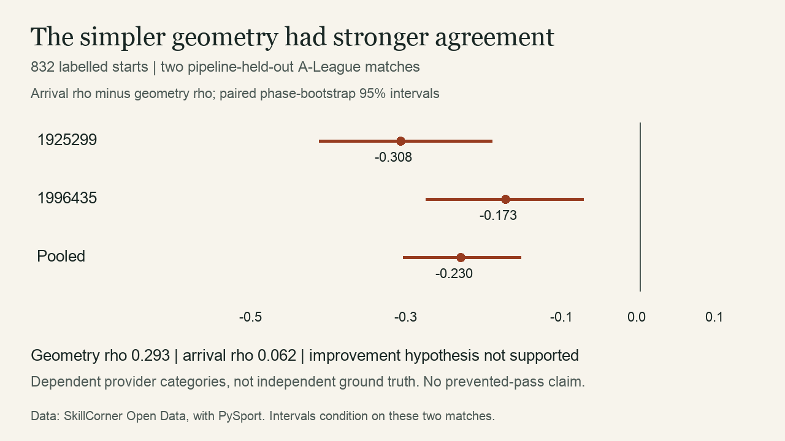
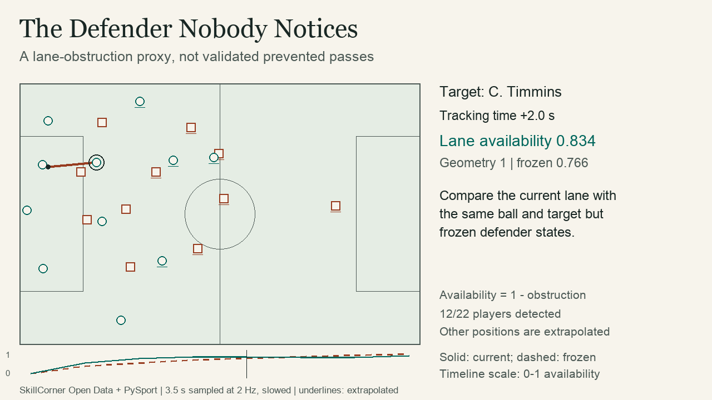

# The Defender Nobody Notices

An open-data research pilot for measuring passing-lane obstruction before a pass is attempted. It compares finite-corridor geometry with approximate defender arrival times and exports a **Defensive Lane Obstruction (DLO)** indicator, interactive pitch replays and a 30-second demonstration.

**[Open the Vercel preview](https://football-analytics-git-cod-ae6a65-prithvirajs-projects-b40fa6af.vercel.app/lane-obstruction/)** · [Deployment record](docs/deployment.md) · [LinkedIn draft](outputs/linkedin-post.txt)

**The added complexity did not improve agreement in this pilot.** On 832 labelled starts from two pipeline-held-out matches, Spearman association with SkillCorner passing difficulty was **0.293 for geometry** and **0.062 for arrival time**. The paired difference was **−0.230**, with a conditional phase-cluster bootstrap 95% interval of **[−0.305, −0.153]**. This is a negative result against dependent provider categories, not independent football accuracy. Parameters were not retuned to reverse it.

[Feasibility assessment and five related methods](docs/feasibility.md) · [Executed results](outputs/results.md) · [Methodology](docs/methodology.md) · [Limitations](docs/limitations.md) · [Public-post draft](outputs/public-post.md)



## Open the smallest end-to-end version

The committed viewer contains three real development possessions and precomputed Python scores. No dependency install or raw-data download is needed to inspect it. From this project directory:

```sh
python3 -m http.server 4183 --bind 127.0.0.1
```

Open [the local replay viewer](http://127.0.0.1:4183/outputs/viewer.html). It also works as a standalone HTML file; relative documentation links need the project folder. Choose a target and defender, scrub or play, show the corridor, and freeze defender states to compare lane availability. Exact tables accompany the pitch and timeline. Dashed player outlines identify extrapolated positions. Nothing auto-plays or silently fits a model.

[30-second silent demonstration](outputs/demo.mp4) · [Viewer HTML](outputs/viewer.html)



## Reproduce from source

Python 3.11+ with NumPy, pandas and Pillow. Recorded environment: Python 3.12.14; see `outputs/provenance.json` for the executed version and `requirements-lock.txt` for exact dependency versions. FFmpeg/ffprobe are open-source system dependencies for the MP4 export and media verification. No paid APIs or credentials.

```sh
cd projects/lane-obstruction  # from repository root
python3 -m venv .venv
source .venv/bin/activate
python -m pip install -r requirements-lock.txt
python scripts/fetch_data.py
python -m unittest discover -s tests -v
python scripts/validate_baseline.py
python -m lane_obstruction --config configs/pilot.json
python scripts/build_viewer.py
python scripts/render_demo.py
python scripts/verify_release.py
```

The first test run skips executed-output tests until outputs exist. Run them again after the experiment; `verify_release.py` does this. `fetch_data.py --reuse-workspace` can reuse verified raw caches from the adjacent Invisible Runner and Open Body projects. Both paths verify every source hash. A fresh public download is approximately 290 MB across the three matches; all raw data remains ignored. A corrupt cached file causes a clear error; remove that file explicitly before refetching. The downloader writes atomically and refuses mismatched content.

The baseline gate must pass on real development data before `python -m lane_obstruction` will score the proposed model. It checks the configuration hash, range, coverage and nonconstant baseline output. To change assumptions, edit a separate config and pass the same `--config path.json` to both commands. Preserve the original outputs first: an experiment rerun overwrites this project's output directory. Report changes as exploratory reuse of already examined test matches.

Optional browser checks require Node.js and Playwright with a local Chromium installation, then the local server above:

```sh
node tests/browser/check.cjs
```

`LANE_VIEWER_URL`, `LANE_BROWSER_CHANNEL` and `LANE_BROWSER_EXECUTABLE` allow an alternate local server/browser. These checks are separate from Python analytical tests.

## Scope and result

| Split | Match | Eligible starts | Labelled paired starts |
| --- | --- | ---: | ---: |
| Development | Auckland FC–Newcastle, 30 Nov 2024, 1886347 | 442 | 436 |
| Evaluation | Brisbane FC–Perth Glory, 21 Dec 2024, 1925299 | 444 | 439 |
| Evaluation | Sydney FC–Adelaide United, 1 Feb 2025, 1996435 | 412 | 393 |

All three are convenient matches with full source tracking. Evaluation matches were excluded from model development **in this implementation** but were already cached for other projects. This is not a pristine prospective test set. The repository index lists 20 matches while its README describes ten; the source audit preserves that discrepancy.

Only 856 of 2,059 evaluation possession starts survive eligibility checks, and 832 have paired labels. None of the eligible starts has all 22 players and the ball detected on camera. Required coordinate coverage therefore includes off-camera extrapolation. The strict observed-subset analysis is unavailable, not a zero effect. Detailed exclusion waterfalls and full-file audit counts are in `outputs/data_audit.json`.

The provider categories are possession-level outputs. Candidate lanes are generated independently from current player locations, not the provider passing-option list. Five-minute-block uncertainty and 12 sensitivity settings are reported without selecting a better-looking parameter setting. The full statistical protocol was written in the feasibility document before scoring.

## Model in brief

- Targets: on-pitch outfield teammates 5–40 m from the ball, with a snapshot offside screen. Need a confirmed carrier, nearby low ball, in-play phase, all 22 positions and valid past defender history.
- Geometry: any defender within 1 m of the straight route, excluding 2 m at each end. Team obstruction is the fraction of blocked lanes.
- Arrival: sample the same route at <=0.5 m spacing; compare a 15 m/s ball with approximate defender arrival using a 0.7 s reaction interval, 5 m/s movement and a 0.5 m control radius. Map the best margin to an uncalibrated bounded index.
- DLO: mean reduction in maximum lane obstruction after removing one defender's model contribution. It discounts shared blocking and measures mathematical marginal obstruction, not causal defensive credit.
- Time: replays hold target identities fixed. The frozen comparison retains current ball/targets but first-frame defender positions and velocities. It isolates a model sensitivity, not a tactical counterfactual.

## Reusable modules and evidence

`data.py` validates source hashes, schemas, joins and past-only snapshots; `baseline.py` implements finite corridors and marginal attribution; `arrival.py` implements reachability; `evaluation.py` computes tie-aware associations and paired clustered uncertainty. `experiment.py` orchestrates the frozen protocol. Replay/publication modules consume executed calculations.

Python `unittest` checks geometry, transformations, physical monotonicity, directional movement, attribution, phase boundaries, missing carrier/history, offside, source frame order, future-frame independence and clustered resampling. Real-output tests independently recompute the reported rank correlations using a separate pure-Python rank implementation and reconcile denominators and marginal totals. See `outputs/verification.json` and `outputs/browser-validation.json` for recorded checks. These engineering checks do not establish football validity.

CSV outputs retain match/event keys; JSON outputs preserve configuration, source receipts and exact assumptions. `scripts/verify_release.py` records code/config/output hashes. HTML embeds only reviewed replay positions and results, without full raw tracking, birthdays, credentials or machine paths. Video uses only those exported positions, no broadcast footage. The post is a draft; nothing has been published or sent.

## Licence and credit

Data: [SkillCorner Open Data](https://github.com/SkillCorner/opendata), released with [PySport](https://pysport.org/), revision `4340d274572876239c154c90bc507a9b3250a656`. Its MIT copyright and permission notice is retained at [SkillCorner-LICENSE](docs/source/SkillCorner-LICENSE). Credit both organisations when reusing derived figures. Project code is separately MIT licensed at [LICENSE](LICENSE). Dependency licences remain with their respective projects. System fonts used for video rasterisation are not redistributed.

This implementation contributes a public, inspectable comparison and temporal ablation study. It does not invent cover shadows, arrival-time interception or receiver availability. Related published work and the distinctions are explained in the feasibility assessment.
