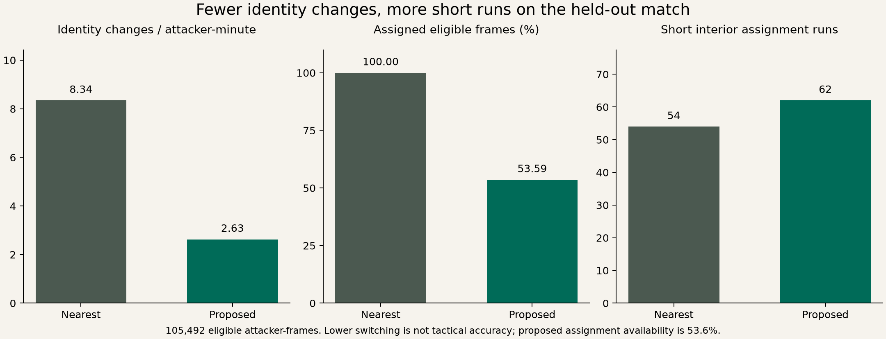

# Pilot results

## Main finding

The temporal heuristic yields fewer identity changes, but its lower assignment availability and increased short-run count prevent a claim of better tactical detection. The real-data short-run hypothesis fails. Synthetic geometric robustness passes the pre-specified engineering criteria. Real marking responsibility remains unvalidated.

## Held-out match: Sydney FC v Adelaide United, 1996435

| Measure | Nearest defender | Proposed |
|---|---:|---:|
| Eligible attacker-frames | 105,492 | 105,492 |
| Eligible attacker-minutes | 175.82 | 175.82 |
| Identity changes, including distinct returns after unassignment | 1467 | 462 |
| Identity changes / attacker-minute | 8.344 | 2.628 |
| Short interior assigned runs (<0.5 s) | 54 | 62 |
| Short runs / attacker-minute | 0.307 | 0.353 |
| Assigned eligible frames | 100.00% | 53.59% |
| Assigned frames outside entry geometry | 46.19% | 7.88% |

All rates use the same eligibility population. Nearest always assigns someone; the proposed method abstains and can retain a defender outside the stricter entry radius. Lower switching and higher geometric support are partly consequences of those design choices. Geometry support is not marking accuracy. The methods disagree on 10.06% of frames where the proposed method assigns a defender; abstentions are excluded from that disagreement denominator.

Proposed-minus-nearest identity-change rate difference: -5.716 per attacker-minute, 95% paired phase-bootstrap interval [-6.223, -5.289]. Short-run rate difference: 0.046, interval [-0.094, 0.177]. These use 301 within-match phase clusters and 2,000 resamples. They do not estimate between-match uncertainty, and dependence across neighboring phases may persist.

The proposed method retrieves 306 held-out candidates: 226 continuous-cover, 36 brief-gap and 44 gap candidates. 237 have all three involved players detected throughout the transfer measurement window. This does not establish that every other defender was detected.

## Observation sensitivity

Requiring detected coordinates for the attacker and all ten opposing outfield players at current and previous three frames leaves 39,547 attacker-frames (65.91 attacker-minutes). On that separately segmented population, the method yields 98 candidates, including 15 gap candidates. Identity-change rates are 8.284 versus 2.503; short interior runs are 16 versus 27. Fragmentation changes which transfers remain observable. Do not interpret the count difference as a measured number of false positives.

## Synthetic geometric evaluation

Reserved seeds 1000-1099 yield 400 controlled trajectories across stationary ambiguity, smooth crossing, delayed geometric cover and missing intervals. There are 200 known identity changes after missing-data resets. Observation noise SD is 0.15 m. Event matching tolerance is 1.5 s.

| Metric | Nearest | Proposed |
|---|---:|---:|
| Event precision | 0.0486 | 0.9750 |
| Event recall | 1.0000 | 0.9750 |
| Event F1 | 0.0927 | 0.9750 |
| Excess switches above scenario true-change counts | 3916 | 0 |
| Median signed matched-change latency (s) | -0.65 | 0.50 |
| Median absolute matched-change latency (s) | 0.65 | 0.50 |

All three pre-specified synthetic hypothesis clauses pass. The proposed method still has 5 unmatched predicted changes and 5 missed changes; zero excess switches does not mean zero event errors. Longest-gap mean absolute error is 0.081 s on 100 gap scenarios. Seed-cluster bootstrap gives a recall-delta interval [-0.04512500000000003, -0.0050000000000000044] and proposed precision interval [0.9548749999999999, 0.995]. These intervals concern simulated noise only.

The stationary synthetic scenario is intentionally near an ambiguous Voronoi boundary, making unrestricted nearest defender switch frequently. The large reduction is specific to that stress test; it cannot be generalized to tactical handoffs in professional matches.

## Threshold and component sensitivity

| Setting | Candidates | Gap candidates | Assigned frames | Identity changes / attacker-minute |
|---|---:|---:|---:|---:|
| radius_4 | 146 | 26 | 39.3% | 1.325 |
| radius_8 | 508 | 66 | 67.2% | 4.004 |
| confirm_3 | 370 | 61 | 57.5% | 3.123 |
| confirm_8 | 224 | 23 | 48.0% | 1.985 |
| margin_0 | 376 | 41 | 53.7% | 3.083 |
| margin_1_5 | 264 | 43 | 53.5% | 2.366 |
| no_motion | 309 | 44 | 53.5% | 2.633 |
| no_structure | 300 | 43 | 53.6% | 2.605 |
| default | 306 | 44 | 53.6% | 2.628 |

The default was retained. The 8 m setting bundles entry, release, graph and prediction radii; the other rows change one parameter/component at a time. Candidate counts depend substantially on the coverage radius and confirmation interval. Motion and local-structure ablations do not establish either component's tactical value because no real labels exist.

## Verification and evidence

- Baseline: 500 independent scalar distance checks per match, 1,000 total.
- Unit/regression tests cover ties, side changes, geometry, hysteresis, prefix causality, unknown/reset behavior, gap measurement, duplicates, missing frames and speed jumps.
- `verify_exports.py` independently recomputes every candidate gap from the assignment CSV and reconciles all main counts and replay bindings.
- `results.json`, `synthetic-results.json`, `sensitivity.csv`, the audit receipts and frozen configuration are the controlling evidence. `review-queue.csv` leaves tactical labels blank for independent annotation.
- `marking-handoffs-demo.mp4` is a 32-second illustrative tracking replay. Its two examples follow the manifest's deterministic observability/length rule, not a performance or representative-sampling claim.

The methodological conclusion is a feasible candidate-retrieval pipeline with a documented stability/availability tradeoff. Tactical accuracy and communication failures remain open empirical questions.
