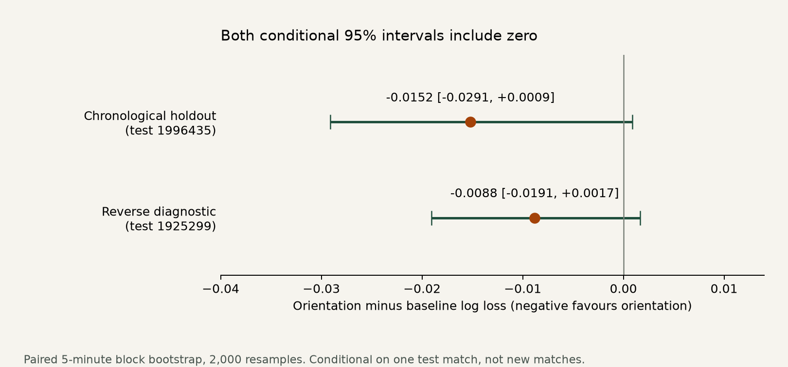

# Open Body

**Does shoulder orientation add information at reception?** A reproducible football analytics pilot using the two free SkillCorner body-pose matches.

Adding orientation reduced held-out log loss in both match directions, but both conditional uncertainty intervals include zero. The predeclared pilot criterion was **not met**. The midfield-only result is mixed. This is a measurement and evaluation project, not evidence that opening the body causes better play.

[Open the live viewer](https://open-body-seven.vercel.app) · [Offline viewer](outputs/viewer.html) · [Watch the 30-second demo](outputs/open-body-demo.mp4) · [Read the results](docs/results.md)



## Question and verified result

Among matched outfield pass receptions, does adding a shoulder-orientation proxy to position and pressure improve prediction of a successful pass gaining at least 5 m within 2 seconds?

| Evaluation | Train / test receptions | Baseline log loss | + orientation | Change | Conditional 95% interval |
|---|---:|---:|---:|---:|---:|
| Earlier match → later match | 665 / 647 | 0.5751 | 0.5599 | −0.0152 | [−0.0291, +0.0009] |
| Reverse diagnostic | 647 / 665 | 0.5256 | 0.5168 | −0.0088 | [−0.0191, +0.0017] |

Negative change favours orientation. These are matched-sample comparisons. Intervals resample five-minute blocks in the test match, holding fitted models fixed. They do **not** estimate generalisation uncertainty across football matches. There are only two match environments.

Midfield-only changes are **+0.0156** on the chronological holdout and **−0.0147** in reverse. Do not turn the broader outfield result into a midfielder-specific claim. The original two-midfielder question remains unresolved.

## What is built

* Streaming, checksum-verified loaders for full pose ZIPs, native tracking and events. macOS resource forks, null periods, substitutions, missing tracking and inactive roster rows are handled explicitly.
* A tested position/pressure baseline, followed by causal shoulder geometry, width/error/alignment gates, circular smoothing and pre-reception net-turn features.
* Match-separated ablation, constant benchmark, log loss/Brier/AUROC, calibration, paired uncertainty, prespecified sensitivity tests and complete-case selection audits.
* Descriptive reception duration, orientation categories, limited retention proxy and vendor EPV change. Future movement alignment is descriptive only.
* A single-file offline viewer with native 2D tracking, rotatable 3D skeleton, real clips and verified results. A 30-second silent MP4 is rendered from the same clips; it contains no broadcast footage.

## Data feasibility

The [Hugging Face release](https://huggingface.co/datasets/SkillCorner/opendata-bodypose) is public, ungated and marked MIT. It contains Brisbane Roar v Perth Glory (21 December 2024, 1925299) and Sydney FC v Adelaide United (1 February 2025, 1996435), with associated tracking/events in [SkillCorner / PySport open data](https://github.com/SkillCorner/opendata). Retain the SkillCorner notice in [NOTICE.md](NOTICE.md) and `docs/source/data_LICENSE.txt`.

Pose is 25 Hz; tracking/events are 10 Hz. The exact relation is `pose_frame = 2.5 * tracking_frame`, but model features must never round up into future frames. Raw pose XY is interpolated and includes inactive roster members. Native tracking controls opponent pressure.

| Coverage | 1925299 | 1996435 |
|---|---:|---:|
| All-roster player-frames with pose | 31.4% | 36.4% |
| Active-player frames with pose | 45.7% | 49.6% |
| Eligible receptions retained after all pose/context gates | 665 / 689 (96.5%) | 647 / 662 (97.7%) |

High reception coverage does not remove selection. In the first match, excluded receptions have different location, pressure and outcome prevalence. Pose/native XY also has substantial outliers despite exact clock alignment; reception samples require agreement within 2 m. The audit reports the entire mismatch distribution instead of treating every synchronized identity as correct.

Read the [feasibility assessment](docs/feasibility.md), [five-method research review](docs/related-work.md), [methodology](docs/methodology.md) and [limitations](docs/limitations.md). The shoulder-vector formula is established prior work. The contribution is an open-data, reception-centred ablation with causal feature timing, explicit selection accounting and inspectable animation.

## Reproduce

Tested with Python 3.14.2 on macOS arm64. Python modules target 3.11+, but the exact lock file may require newer Python. Use Python 3.14 for the pinned environment. FFmpeg is required only for MP4 rendering. The offline viewer needs only a modern browser and no CDN, API key, account or runtime server.

From this project directory:

```bash
python3 -m venv .venv
.venv/bin/python -m pip install -r requirements-lock.txt
.venv/bin/python scripts/download_data.py
.venv/bin/python -m pytest -q tests/test_baseline.py
.venv/bin/python -m open_body baseline
.venv/bin/python -m open_body orientation
.venv/bin/python -m pytest -q
.venv/bin/python -m open_body viewer
MPLCONFIGDIR=/tmp/open-body-mpl .venv/bin/python scripts/render_demo.py
```

Or run `OPEN_BODY_PYTHON=python3.14 bash scripts/reproduce.sh`. Downloads total about 1.46 GB including tracking and companion files; allow roughly 2 GB plus the Python environment. Pose ZIP members are streamed, never extracted. Large raw inputs and intermediate shoulder-window caches are ignored by Git. Public URLs are pinned to immutable revisions and checked against `data/source-lock.json`; pose hashes also match the publisher's manifest. No paid API or unlicensed data is used.

Run the stages from this directory. `configs/pilot.json` defines thresholds, features, split, seed and sensitivities; `--config` selects another project-relative config. The orientation stage requires a matching baseline validation marker. Changing baseline/configuration invalidates it. Pose caches are bound to input hashes and extraction code. A new experiment configuration is exploratory, not another untouched holdout test.

To preview over HTTP if your browser restricts local HTML, run `.venv/bin/python -m http.server 8766 --directory outputs` and open the displayed local address followed by `/viewer.html`.

## Inspect the evidence

| Artifact | Purpose |
|---|---|
| `data/provenance.json`, `data/source-lock.json` | Exact URLs, revisions, sizes and SHA-256 hashes |
| `outputs/baseline_audit.json`, `baseline_results.json` | Exclusions, coordinate checks and baseline on all eligible receptions |
| `outputs/coverage.json` | Full-match pose audit, active/roster denominators, reception gates and selected/rejected comparisons |
| `outputs/receptions_baseline.csv`, `receptions_orientation.csv` | One row per eligible reception, with features and explicit outcomes |
| `outputs/heldout_predictions.csv`, `results.json` | Recomputable per-event probabilities, losses and paired model comparisons |
| `outputs/sensitivity_results.json`, `orientation_categories.csv` | All declared checks and unadjusted outcome descriptions |
| `outputs/viewer_data.json`, `viewer.html`, `open-body-demo.mp4` | Deterministically selected real clips and visual explanation |
| `docs/validation.md`, `docs/public-post.md` | Verification record and an unpublished technical post draft |

Core modules are small and independent: `data.py`, `orientation.py`, `models.py`, `baseline.py`, `experiment.py`, `viewer.py`. Tests check geometry, causal timing, schema edge cases, train-only transforms and independent reconciliation of real labels, coordinates and held-out losses.

The analysis and offline viewer are ready to inspect and reproduce. Deployment instructions are in `docs/deployment.md`; the LinkedIn/X drafts remain unpublished.

The concise [LinkedIn post draft](docs/linkedin-post.md) follows the project owner’s preferred format and includes the published links.
