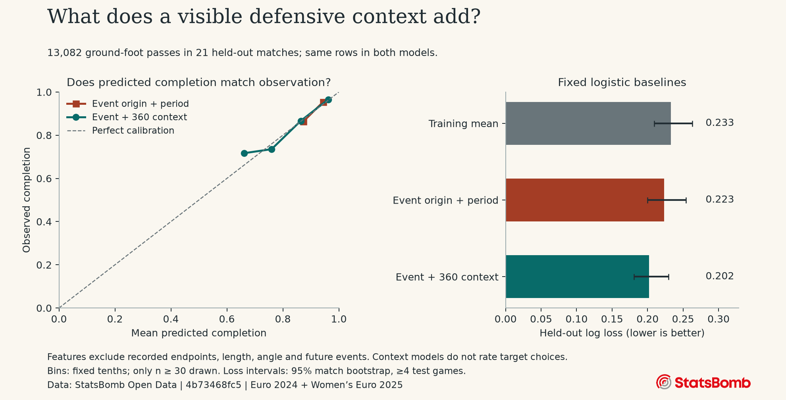

# Can AI identify missed progressive passes?

This experiment produces a review queue of hypothetical visible lanes. It does not establish that a player missed a better pass.

Source revision: `4b73468fc5b0f1950f9f66fada70ad3a4f9327cb`. Reproduce with `python -m passlab.pipeline --full --models all`.

## What was observed

- 82 matches, 54,200 eligible ground-foot passes; 48,205 have a frame with visible defenders.
- The endpoint-free recipient proxy retains 2,122/48,205 (4.4%) of those observations.
- Retained proxy completion: 96.2%; excluded completion: 93.1%. This comparison describes selection, not model accuracy.
- Train/test match counts: 61/21. Split seed: 2026.

## Holdout evidence

| Population | Model | Features | Train passes | Test passes | Log loss | Brier | AUC |
| --- | --- | --- | ---: | ---: | ---: | ---: | ---: |
| context | constant | mean | 35,123 | 13,082 | 0.2329 | 0.0582 | 0.500 |
| context | logistic | event | 35,123 | 13,082 | 0.2232 | 0.0565 | 0.649 |
| context | boosted | event | 35,123 | 13,082 | 0.2117 | 0.0540 | 0.704 |
| context | logistic | 360 | 35,123 | 13,082 | 0.2022 | 0.0540 | 0.776 |
| context | boosted | 360 | 35,123 | 13,082 | 0.1917 | 0.0518 | 0.812 |
| recipient_proxy | constant | mean | 1,559 | 563 | 0.1536 | 0.0343 | 0.500 |
| recipient_proxy | logistic | target_geometry | 1,559 | 563 | 0.1532 | 0.0344 | 0.583 |
| recipient_proxy | boosted | target_geometry | 1,559 | 563 | 0.1523 | 0.0341 | 0.634 |
| recipient_proxy | logistic | target_360 | 1,559 | 563 | 0.1262 | 0.0306 | 0.839 |
| recipient_proxy | boosted | target_360 | 1,559 | 563 | 0.1271 | 0.0322 | 0.854 |

Adding 360 origin context changes fixed-logistic holdout log loss by -0.0210 on exactly the same passes. A negative difference is an improvement on this split. This is a narrow origin-only event comparison, not a replication of Hudl’s target-aware event baseline.

Bars include 95% match-cluster bootstrap intervals when at least four test games exist. These are conditional on the fixed trained model and split; they do not measure retraining uncertainty. No target model, hyperparameter or review threshold was selected using holdout performance.

## The exploratory review queue

Of 563 held-out proxy events, 410 have a chosen-target proxy inside every marginal guard. The fixed rules flag 184 candidate lanes in 146 events. These are review hypotheses, not confirmed missed passes.

Across that held-out proxy population, 1,596/3,993 visible candidate lanes receive a probability. No candidate outcome is observed, so accuracy or value improvement of these flags cannot be measured here.

## What the candidate estimates mean

The candidate model uses a recent pre-pass actor location to place an annotated recipient into the anonymous current frame. That assignment can be wrong. The training population overrepresents recently involved players and annotated recipients. Geometry-only and spatial target models share this same selected population; their scores cannot be compared directly with the broader context population.

Alternative recipients are current visible teammate positions. Only targets passing every marginal training-range guard and visibility check receive an experimental probability. Passing these guards does not establish joint statistical support, feasibility, offside legality or counterfactual calibration. Forward gain is target x minus origin x in normalized StatsBomb units. Expected positive gain is xPass times max(forward gain, 0), assigning zero gain on failure. It ignores the cost of a turnover and has no claim to represent goal threat.

A review flag requires an inferred actual recipient, both targets inside the guards, an alternative at least 10 units forward, xPass at least 0.70 and expected positive gain at least 5 units above the inferred chosen target. These fixed exploratory cutoffs are not tactical truth. There is no observed outcome for an unchosen pass. No player ranking or tactical explanation is inferred.

## Coverage and limitations

| Tournament | Matches | Eligible passes | With observed defenders | Proxy targets |
| --- | ---: | ---: | ---: | ---: |
| Euro 2024 | 51 | 36,782 | 32,847 | 1,438 |
| Women's Euro 2025 | 31 | 17,418 | 15,358 | 684 |

Missing or off-camera opponents, absent player IDs, snapshot timing, recipient annotation and domain shift remain material limitations. The event pressure tag is retained for display but excluded from predictions because its timing can overlap event duration. No endpoint-derived length/angle, actual endpoint, duration, future receipt, result, player ID or match ID enters the model. The sample mode selects earliest matches and is a smoke test, not a representative tournament estimate.

Per-match parsing audits, split membership, per-tournament model metrics, feature lists, source hashes and environment versions are stored locally in the run outputs. Raw snapshots and pass-level tables are deliberately excluded from version control under the source agreement.

## Sources and attribution

- [StatsBomb Open Data](https://github.com/hudl/open-data), event v4.0.0 and 360 v1.0.0 specifications; [data terms](../docs/source/LICENSE.pdf).
- Conor Sharpe, [xPass 360: Upgrading Expected Pass Models](https://www.hudl.com/blog/xpass-360-upgrading-expected-pass-xpass-models), 17 June 2025. Conceptual reference; no equivalence to the proprietary model is claimed.

Original code is MIT licensed. StatsBomb data and branding retain the upstream terms; no commercial reuse or raw data redistribution is granted by this project.
