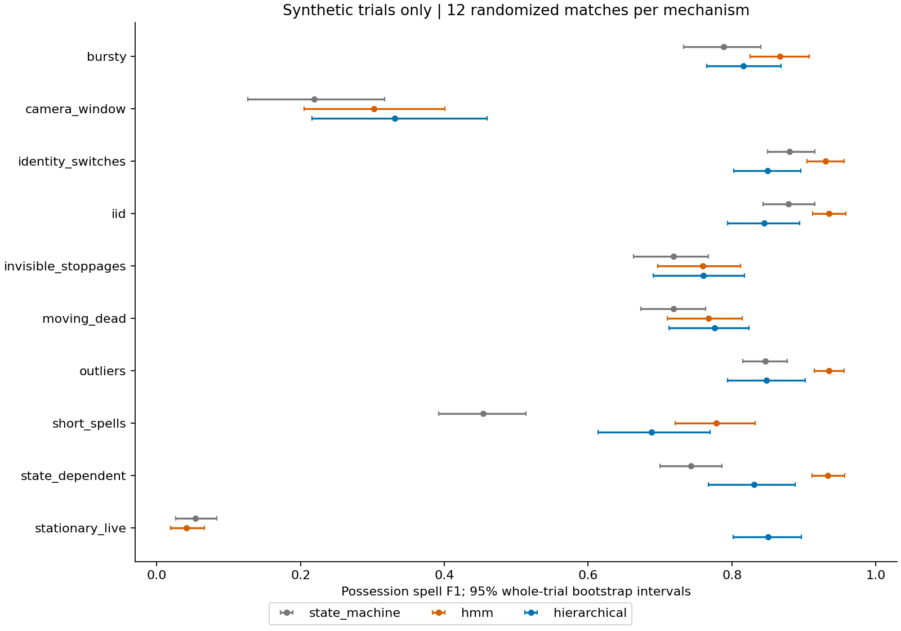

# Possession Lab

**[Open the research explorer](https://football-analytics-self.vercel.app/possession-lab/)** · [Findings](reports/phase1/comparison.md) · [Methodology](docs/phase1/MODEL.md) · [Hosting guide](docs/deployment.md)

Who has the ball when the ball disappears? A football possession inference research
project with independent Python modules and an interactive pitch explorer. Compare
models, change synthetic tracking failures and inspect cases where exactly the same
observations support different hidden possession states.

The public demo uses deterministic synthetic scenarios and excerpts from two
[Metrica Sports public sample matches](https://github.com/metrica-sports/sample-data).
It does not contain restricted competition assets. Public sample predictions have
no accuracy scores because independent trusted possession labels are unavailable.

## Quick start: the published website

Python 3.10+; standard library only. No account, API key or data download.

```sh
# From the repository root; builds all existing projects plus Possession Lab
python3 scripts/build_website.py
python3 -m http.server 4173 --bind 127.0.0.1 --directory dist
```

Open `/possession-lab/`. To build this project alone:

```sh
cd projects/possession-lab
python3 scripts/build_website.py
python3 -m http.server 4173 --bind 127.0.0.1 --directory dist
```

The offline builder restores a checksum-verified release. Python inference runs on
the visitor's device through Pyodide 0.29.2, with NumPy and pandas bundled in the
static release. The first playground use loads about 20 MB of runtime assets.
Saved examples display while it loads. Numerical imports are checked and package
loading retries before the manual retry control is offered.

## Three research experiences

- **Model comparison:** physical pitch playback, a shared frame timeline, model
  transitions, error inspection and whole-scenario metrics. Four core baselines,
  four unchanged official reference votes and six historical ablations are available.
- **Tracking failure playground:** change the seed, missing-ball interval, noise,
  random visibility loss or selected failure mechanisms. The original Python
  models run in a Web Worker; the hidden synthetic possession schedule stays fixed.
- **Observability explorer:** paired synthetic worlds with identical tracking and
  opposing hidden states. Optional noisy event cues and shared uninformative tags
  demonstrate the difference between additional information and temporal smoothing.
  Hypothetical event intervals are inspectable; they are not actual match tags.

## Run the Python research package

Python 3.14 is the tested native environment. The original lock and model files are
preserved; the browser has a separate pinned numerical environment.

```sh
cd projects/possession-lab
python3 -m venv .venv
source .venv/bin/activate
python -m pip install -r requirements.lock.txt
python -m pip install --no-build-isolation --no-deps -e .

# Public official documentation, scorer and supplied sanity-check files only.
# This checkout does not grant access to restricted competition assets.
git clone https://github.com/metrica-sports/more-than-a-hack-2027.git ../more-than-a-hack-2027
git -C ../more-than-a-hack-2027 checkout f8f2629ff1e0985f81d7e59d8413678514ee1530

# Restore exact reviewed synthetic outputs, then run the unchanged research tests.
python scripts/restore_benchmarks.py
python -m pytest -q
```

The synthetic archive restores 2,047 historical output files with per-file SHA-256
checks. It includes the 108 original truth/prediction CSVs and the files needed for
the 408-file Phase 1 freeze. It excludes public competition labels and all actual
match tracking. Changed local result files are not silently overwritten.

```sh
bash scripts/reproduce.sh         # original baseline sanity and synthetic runs
bash scripts/reproduce_phase1.sh  # failure-driven tracking-only study
bash scripts/reproduce_phase2.sh  # imperfect event-evidence study
```

See [research history and original commands](README_RESEARCH.md) and the prospective
[Phase 1](docs/phase1/PROTOCOL.md) and [Phase 2](docs/phase2/PROTOCOL.md) protocols.
The original public five-minute labels enter only the supplied-baseline sanity
check. They are never training, tuning or model-selection data.

## Findings and evaluation

Phase 1 evaluated **1,680 method runs across 14 scenarios**, with 12 synthetic
trials per scenario and whole-trial uncertainty intervals. On stationary-live
trials, the hierarchy achieved possession-spell F1 **0.851 [0.802, 0.897]** versus
**0.041** for the original HMM. The HMM remained better under some visibility
mechanisms. These are synthetic diagnostics, not competition improvements.

Moving-dead and invisible-stoppage D recall remained zero for the hierarchy.
Good possession-spell scores therefore did not establish successful stoppage
detection. Identical-observation pairs demonstrate a limit: tracking-only methods
must give the same prediction in both worlds. Additional noisy evidence can help
only when it carries independent information about the hidden state.

[Phase 1 findings](docs/phase1/REPORT.md) · [Scenario comparisons](reports/phase1/comparison.md) · [Phase 2 findings](docs/phase2/REPORT.md) · [Event-evidence comparisons](reports/phase2/comparison.md)



SpellF1 uses the unchanged official scorer across IoU thresholds 0.3 to 0.7.
MacroF1 averages H/A/D and assigns zero to absent classes. Ground-truth X is
ungraded; predicted X counts as a frame miss but is filled within valid runs for
spell scoring. Separate typed-boundary diagnostics use a 25-frame tolerance and
report missed/spurious boundaries alongside matched timing error. Undefined
metrics remain unavailable. The website's single-scenario scores are not estimates
of generalization or trial uncertainty.

## Validation and reproduction

**170 tests pass locally**, including the original **165 Python tests** covering research behaviour, public baseline
reproduction, missing observations, period boundaries, physical normalization,
H/A/D/X semantics, CSV output, exact-observation twins and the browser JSON interface.
Five additional publication checks cover safe archive restoration and release integrity.

The release builder verifies its source fingerprint, archive checksum and every
restored asset. Historical benchmark files are preserved byte-for-byte in a separate
archive. See the [explorer verification report](docs/explorer/REPORT.md) and
[design QA](docs/explorer/DESIGN_QA.md). GitHub Actions runs the project tests and
builds the portfolio without downloading match tracking.

## Data, licences and scope

- Public official reference code and documentation: Metrica Sports challenge commit
  `f8f2629ff1e0985f81d7e59d8413678514ee1530`. The official files and scorer are unchanged.
- Public Metrica sample CSVs: commit `e706dd506b360d69d9d123d5b8026e7294b13996`.
  The demo contains the first 1,000 frames from each of Sample Games 1 and 2.
  Source hashes, attribution and coordinate conventions accompany the release.
- Original research code is MIT. Public data and bundled numerical dependencies
  retain their source terms; see [attribution and notices](THIRD_PARTY.md).

Tracking is normalized through a separate adapter to a 105 × 68 m pitch. Slot
numbers are not player identities. HMM/hierarchy are offline temporal decoders;
later observations can affect earlier predictions. Synthetic motion and missingness
remain simplified. The event experiments use a latent action process and a separate
noisy annotation process, not fabricated tags on real match frames.

No restricted data, competition footage or private logs are distributed. Restricted
assets must stay outside Codex-accessible directories. No hand-labelled competition
frames or actual-competition performance claims are part of this project.
