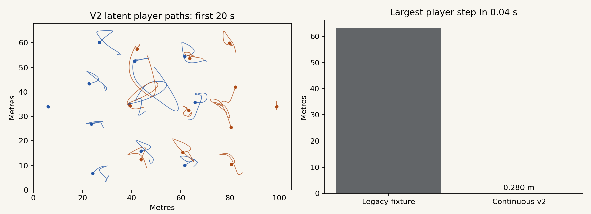

# Continuous motion v2

2026-11-01. This is a visual and data-engineering correction, not a new possession
model or a claim of improved real-match accuracy.

## Why change the motion?

Inspection found that the original synthetic generator translated most players
with a shared small sinusoid, reassigned a carrier's coordinates near the ball,
and froze every player during the stationary-live example. In the clean fixture,
the largest player displacement between adjacent 25 fps frames was 63.091 m.
Those fixtures were useful for isolated feature tests but misleading as football
animations. They remain intact as labelled legacy stress tests. The original
models, scorer, 408 frozen Phase 1 files and 108 legacy CSVs are unchanged.

## New latent movement, separate observations

`src/possession_lab/motion_v2.py` generates a deterministic 125-second passage at
25 fps on a 105 × 68 m pitch. Each side has 11 tracking slots with 4-3-3 role
anchors. Independent smooth intentions, carrier support, a nearest-opponent press,
partial marking and soft avoidance determine desired velocities. Position changes
only by integrating velocity. Players have speed at most 7 m/s and acceleration
at most 3 m/s²; goalkeeper desired speed is capped at 2.2 m/s.

Scripted receptions select actual receiver positions. Quintic pass paths match
release/reception position, velocity and acceleration, with checked ball speed
and acceleration limits of 35 m/s and 35 m/s². Possession changes at receptions;
the releasing side retains possession during a pass. Stops at 42–48 s and
86–92 s ease the ball to rest while players reposition. Restarts depart at the
end of those intervals. In the stationary-live mechanism the ball is still at
14–18 s while off-ball players continue walking.

These are hand-specified illustrative assumptions. The simulator has no learned
tactics, collision/contact dynamics, height, kicking biomechanics, authentic
referee process or empirically calibrated activity distributions. Smoothness
alone does not establish football realism. The release is one continuous passage;
legacy tests retain period/halftime coverage.

`observe` copies the latent arrays before applying Gaussian measurement noise,
independent ball dropout, a controlled missing interval, player gaps or identity
swaps. Observed jumps from noise or slot swaps are expected and do not imply a
latent speed-limit failure. Truth is never reconstructed from noisy observations.

## Prefer real movement for the playground

The playground defaults to Metrica's public Sample Game 1; Sample Game 2 and v2
are selectable. Only loss and noise are applied to public excerpts. The first
1,000 frames and original coordinate adapter are unchanged. Full-precision adapter
arrays are packaged separately from rounded display positions so zero-intervention
inference reproduces all 14 original public prediction sequences. Accuracy metrics
remain null, because there are no independent trusted possession labels here.
Simulated corruption is not attributed to the original dataset.

## Moving observability pair

The new default pair shares every ball/player observation, including motion.
During frames 150–299, one world has a private live ruling and the other a private
stoppage. Players can continue moving after a whistle. A public action-cue channel
and a separate noisy annotator supply optional hypothetical event evidence.
Private rulings and truth are not passed to the annotator. With no cues, or the
same uninformative tags, deterministic predictions cannot exceed 50% balanced
target accuracy across the contradictory pair. This is a constructed information
limit, not an estimate of how often such situations occur in football.

For the saved moving example, the current probabilistic fusion also stays at
50% with independent noisy cues. It does not automatically exploit every new
signal. This failed example is retained; the older static pair demonstrates a
different outcome. No tags are fabricated for public match frames.

## Validation and results

- 199 Python tests pass: the original 170 plus 29 motion/interface checks.
- Seeded tests cover speeds/accelerations, finite coordinates, different player
  paths, goalkeeper location, receiver contact, walking during a still ball,
  repeatable corruption, immutable latent arrays and exact-observation twins.
- Four existing Node request tests pass. The independent fixture audit rebuilds
  metrics for 456 synthetic model outputs across the 25-case release; public
  outputs have no accuracy metrics.
- Local browser Python was exercised for both public interventions and v2
  generation. Its separately pinned numerical versions are shown with results.
- Fixed evaluation seeds 301–305 across five mechanisms produce 25 trials and
  100 reported core-method runs. Whole-trial bootstrap intervals use 2,000 draws.
  Worst latent player step is 0.279853 m. Median native full-pipeline time,
  including all 14 variants, is 372.7 ms on this development machine.

The [comparison table](../reports/motion-v2/comparison.md) and trial CSVs are
separate from historical experiments. On ordinary v2 trials, mean spellF1 is
0.778 for the state machine, 0.459 for HMM and 0.552 for the hierarchy. The hierarchy
has zero D recall. Five trials on one scripted family provide limited uncertainty
coverage and no evidence of real-match improvement. Do not pool these scores with
Phase 1 or tune models solely to this generator.



Reproduce from the package directory after the documented research setup:

```sh
python -m pytest -q
node --test explorer/tests/requests.test.cjs
python scripts/evaluate_motion_v2.py
python explorer/scripts/build.py
python scripts/audit_fixture_metrics.py --data explorer/dist/data
python scripts/package_website.py --input explorer/dist
```

Next, use public movement for visual demonstrations, retain legacy generators for
specific regression tests, and evaluate future models on independently designed
observation mechanisms. Trusted real possession labels would be needed for any
claim about match accuracy. Restricted assets remain outside this workflow.
