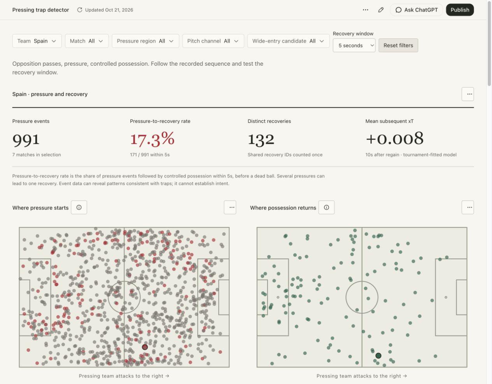

# Pressing trap detector

**Football question:** Where does Spain actually win the ball, and what opposition passing patterns precede pressure?

**[Open the live dashboard](https://football-analytics-self.vercel.app)** · [Methodology](docs/methodology.md) · [Article](docs/where-does-spain-win-the-ball.md) · [CI checks](https://github.com/prithvi-kaizen/football-analytics/actions/workflows/check.yml)

An event-data analysis and interactive dashboard covering all **51 Euro 2024 matches**, **24 teams**, **187,924 source events** and **12,891 eligible pressure events**. Spain is the default view; Germany and every other tournament team are available for comparison.



## What the dashboard does

- Filters by team, match, pressure region, pitch channel, wide-entry candidate and recovery window.
- Links a pressure event to preceding opposition passes from the same possession.
- Tests whether controlled possession returns within 3, 5, 8, 10 or 15 seconds, stopping at dead balls and period boundaries.
- Shows pressure locations and distinct recovery locations in a consistent attacking frame.
- Replays recorded events with play/pause, event stepping and a keyboard-accessible timeline.
- Compares opposition pass direction, recovery regions and team conversion rates.
- Reports signed xT changes and shot xG in the 10 seconds after a regain.

The published dashboard is a static historical snapshot. It does not use live feeds, scraped match data or tracking. Its ball animation interpolates between recorded event locations.

## Findings from Spain's tournament

| Definition | Pressure events | Successful pressure events | Pressure-to-recovery rate | Distinct regains |
| --- | ---: | ---: | ---: | ---: |
| Recovery within 5 seconds | 991 | 171 | 17.3% | 132 |
| Recovery within 10 seconds | 991 | 280 | 28.3% | 170 |

Of the 132 five-second distinct regains, **58 occur in the middle third, 57 in the defensive third and 17 in the attacking third**. These are regains associated with recorded pressure, not every occasion on which Spain win the ball.

The wide-entry heuristic identifies 133 pressure events; 21 lead to a regain within five seconds (15.8%). This subset does not establish that inviting the wide pass was intentional or more effective than other pressing patterns.

Read the full analysis: [Where does Spain actually win the ball?](docs/where-does-spain-win-the-ball.md).

## Run the dashboard

From the repository root:

```sh
python3 projects/pressing-trap-detector/scripts/build_website.py
python3 -m http.server 4173 --bind 127.0.0.1 --directory projects/pressing-trap-detector/dist
```

Open [http://127.0.0.1:4173](http://127.0.0.1:4173). Python 3.10+ is sufficient; there are no pip dependencies. Do not open the HTML with `file://`: the dashboard loads its reviewed snapshot over HTTP.

The `web/` directory contains a compiled dashboard and a lossless compressed copy of all reviewed records. The build verifies SHA-256 hashes for the HTML, compressed data and decompressed snapshot before writing `dist/`. It neither downloads data nor retrains the model. A fresh clone can serve the website without a Codex installation.

## Reproduce the extraction

From this project folder:

```sh
cd projects/pressing-trap-detector
python3 scripts/download_data.py
python3 scripts/build_dataset.py
python3 scripts/validate_dataset.py
python3 -m unittest discover -s tests -v
```

The downloader uses the commit pinned in [`data/manifest.json`](data/manifest.json), including all 51 event-file SHA-256 hashes. Internet access and about 153 MB of raw-download space are required. To deliberately select another source revision, use `python3 scripts/download_data.py --revision COMMIT_SHA`.

Outputs:

| File | Contents |
| --- | --- |
| `outputs/pressures.csv` | One row per eligible pressure, excluding replay payloads |
| `outputs/reviewed.json` | Complete reviewed dashboard evidence and provenance |
| [`outputs/xt_model.json`](outputs/xt_model.json) | Fitted 12×8 grid, action count and convergence details |

Raw downloads and the large uncompressed intermediates are gitignored. Running the extraction does not automatically overwrite the published website release.

## Measurement choices

A wide-entry candidate requires the last completed opposition pass to move at least 8 lateral pitch units, finish at opposition-frame y≤18 or y≥62, arrive 0–3 seconds before pressure and finish within 15 units of that pressure. It need not be received by a full-back. These thresholds are heuristics and have not been labelled against video.

The denominator is a located Pressure event against an opposition possession. Several pressures can share one regain. Pressure-to-recovery rates use all pressure anchors; regain counts and post-recovery threat deduplicate recovery event IDs.

The xT grid is fitted on this tournament with shot xG as terminal reward. It is an **in-sample descriptive model**, with no independent predictive validation. It sums signed changes from completed passes and carries and does not assign turnover penalties to unsuccessful passes. Its output is not total possession value and should not be added to shot xG.

Team comparisons are descriptive and unadjusted for opponents, match count, minutes or score state. Longer recovery windows capture more delayed regains and weaken any causal interpretation. Event data can detect patterns consistent with traps but **cannot prove defensive intent**.

See the complete [methodology and definitions](docs/methodology.md) and [recorded verification](docs/verification.md).

## Code and deployment

```text
pressing-trap-detector/
├── dashboard/src/          # Authored React, CSS and provider logo
├── data/                   # Pinned source manifest and original data licence
├── docs/                   # Methods, article, verification and deployment
├── outputs/                # Model grid and dashboard screenshot
├── scripts/                # Download, extraction, validation and website build
├── tests/                  # Focused detector tests
└── web/                    # Integrity-checked compiled release and compressed evidence
```

The Python analysis is independent of the UI. The authored UI imports the Codex Data app runtime. That optional authoring runtime is not vendored into this public repository; compiling UI edits requires it. The already-compiled website can be rebuilt and deployed using only Python. This separates serving a verified release from recompiling its interface, and makes the current portability limit explicit.

GitHub Actions run the detector tests and verify the website release on pushes and pull requests. The root [`vercel.json`](../../vercel.json) deploys this project from the repository root. See [deployment and release refresh instructions](docs/deployment.md). No environment variables, database or paid data subscription are required.

## Attribution and third-party terms

Data: **[StatsBomb Open Data](https://github.com/hudl/open-data)**, UEFA Euro 2024, competition `55`, season `282`. Source revision: `4b73468fc5b0f1950f9f66fada70ad3a4f9327cb`.

The [original StatsBomb licence](data/STATSBOMB_LICENSE.pdf) is retained. The dashboard includes StatsBomb's original logo from the same repository. The data and logo retain their provider's terms; no blanket code licence is applied to them or to the third-party compiled UI runtime.
