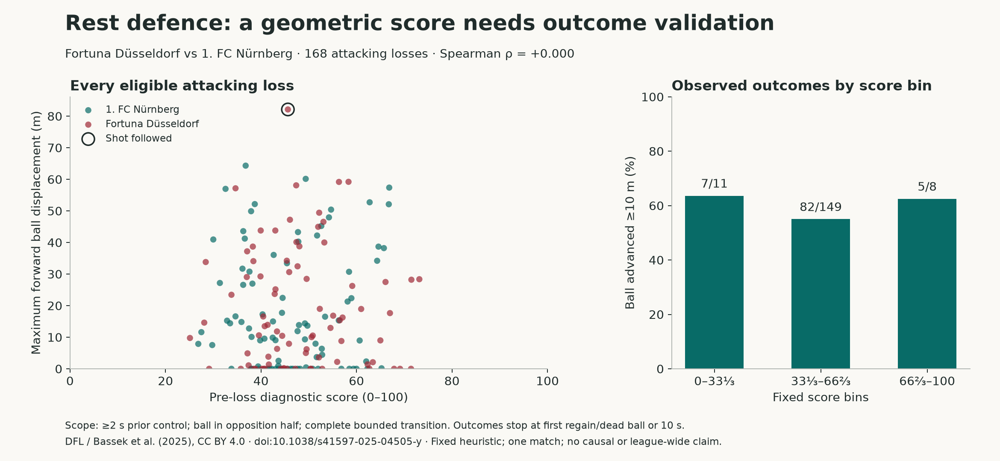

# Possession share does not measure rest defence

A reproducible method demonstration using **Fortuna Düsseldorf vs 1. FC Nürnberg**. Source scope: full source match. Generated from the pipeline outputs, without invented events or tactical intent labels.



## What the tracking shows

The pipeline accepted **293** stable live-ball possession switches. **168** were uncensored attacking losses with a defined score: at least two seconds of prior control and a pre-loss ball in the opposition half. Of these, **94** were followed by at least 10 m of forward ball movement and **1** by a shot before the bounded window ended.

Possession shares of live, valid frames with known control were **Fortuna Düsseldorf: 62.8%; 1. FC Nürnberg: 37.2%**. These are tracking-frame shares, not provider match-statistics or controlled-attack durations.

| Losing team | Attacking losses | Ball advanced ≥10 m | Shots | Median outfield behind |
|---|---:|---:|---:|---:|
| 1. FC Nürnberg | 87 | 47 | 0 | 9 |
| Fortuna Düsseldorf | 81 | 47 | 1 | 8 |

## Did the score identify more dangerous transitions?

The predeclared equal-weight score had a within-match Spearman rank correlation of **+0.000** with maximum forward ball displacement. This readout does not validate the score as a predictor. Shots were too sparse in the attacking-loss subset to support a useful shot-risk conclusion.

| Fixed score bin | Transitions | Ball advanced ≥10 m | Shots |
|---|---:|---:|---:|
| 0–33⅓ | 11 | 7 | 0 |
| 33⅓–66⅔ | 149 | 82 | 1 |
| 66⅔–100 | 8 | 5 | 0 |

## What this adds to a possession statistic

Both snapshot `J03WPY-secondHalf-124938` and `J03WPY-secondHalf-151958` had **10 outfield players behind the ball**. Their central-grid exposed fractions were **37.3%** and **98.0%**, respectively. These are inspectable geometric measurements under the stated thresholds; equal behind-ball counts can describe different spatial protection.

This establishes why possession share and a behind-ball headcount cannot substitute for spatial inspection. It does **not** establish that either team deliberately used an unsafe structure or that central exposure caused the next attack. Video review, player motion, pass feasibility and more matches are needed for that explanation.

## Reliability and limits

120/168 reported attacking losses have a winning-team action within ±2 s of the tracking anchor. Event timing remains approximate, except for available corrected shot frames. 0 accepted windows were censored; 1 snapshot scores were undefined because the clipped central grid had no cells. Neither is silently replaced with zero.

The chart's bins are fixed in advance, contain unequal sample sizes, and are descriptive counts. Turnovers within one match are dependent. Progression can include a pass in flight. The fixed score ignores speed, orientation, aerial travel, offside and marking assignments. No model was trained, no held-out predictive result is claimed, and no causal or league-wide conclusions follow.

## Reproduce

```sh
python -m rest_defence --match J03WPY
python -m rest_defence.report --result outputs/J03WPY
```

Data: **Deutsche Fußball Liga (DFL)**. Bassek, M., Rein, R., Weber, H. & Memmert, D. (2025). *An integrated dataset of spatiotemporal and event data in elite soccer*. Scientific Data 12, 195. [Paper](https://doi.org/10.1038/s41597-025-04505-y); [original data, version 1](https://doi.org/10.6084/m9.figshare.28196177.v1); [CC BY 4.0](https://creativecommons.org/licenses/by/4.0/). Coordinates are rotated and metrics derived. [Full methodology](../../docs/methodology.md).
