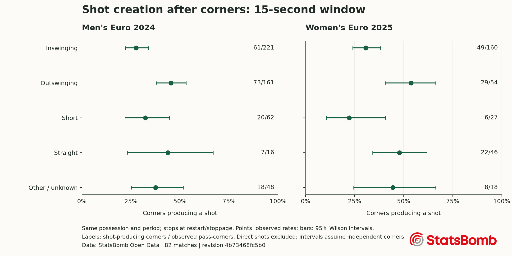

# TacticAI Lite: what public corner data can tell us

I built a simplified, open-data corner-kick intelligence tool inspired by TacticAI. It links event sequences to partial 360 snapshots, groups visible configurations and checks a simple shot-creation baseline. It does not reproduce TacticAI’s proprietary data, model or counterfactual suggestions.

## Data and scope

The pinned StatsBomb revision `4b73468fc5b0f1950f9f66fada70ad3a4f9327cb` contains the selected 82 matches. The pipeline extracted 817 corners; 485 (59.4%) have a linked frame. 0 outcomes were censored. 43 off-pitch or otherwise invalid player entries were excluded from the corner frames, rather than clipped into the pitch.

## Observed results

| Tournament | Corners | Shot-producing corners | Rate | Linked frames |
|---|---:|---:|---:|---:|
| Men's Euro 2024 | 512 | 183 / 512 | 35.7% | 290 |
| Women's Euro 2025 | 305 | 114 / 305 | 37.4% | 195 |



| Tournament | Delivery | Shots / corners | Rate | 95% Wilson interval |
|---|---|---:|---:|---:|
| Men's Euro 2024 | Inswinging | 61/221 | 27.6% | 22.1% to 33.8% |
| Men's Euro 2024 | Other / unknown | 18/48 | 37.5% | 25.2% to 51.6% |
| Men's Euro 2024 | Outswinging | 73/161 | 45.3% | 37.8% to 53.1% |
| Men's Euro 2024 | Short | 20/62 | 32.3% | 22.0% to 44.6% |
| Men's Euro 2024 | Straight | 7/16 | 43.8% | 23.1% to 66.8% |
| Women's Euro 2025 | Inswinging | 49/160 | 30.6% | 24.0% to 38.2% |
| Women's Euro 2025 | Other / unknown | 8/18 | 44.4% | 24.6% to 66.3% |
| Women's Euro 2025 | Outswinging | 29/54 | 53.7% | 40.6% to 66.3% |
| Women's Euro 2025 | Short | 6/27 | 22.2% | 10.6% to 40.8% |
| Women's Euro 2025 | Straight | 22/46 | 47.8% | 34.1% to 61.9% |

The shot-window threshold changes the measured rate. Keeping possession/stoppage rules fixed:

| Tournament | Window | Shots / corners | Rate |
|---|---:|---:|---:|
| Men's Euro 2024 | 10 s | 169/512 | 33.0% |
| Men's Euro 2024 | 15 s | 183/512 | 35.7% |
| Men's Euro 2024 | 20 s | 187/512 | 36.5% |
| Women's Euro 2025 | 10 s | 107/305 | 35.1% |
| Women's Euro 2025 | 15 s | 114/305 | 37.4% |
| Women's Euro 2025 | 20 s | 118/305 | 38.7% |

The 4 directly shot corners are included in the overall counts but excluded from this delivery chart/table and the classifier. They make the shot outcome positive by definition, so their 100% shot rate cannot be compared as evidence of a better delivery tactic.

These are associations under a declared event definition. They do not establish that changing delivery would change shot probability. Small categories and within-match dependence make tactical rankings unreliable. Wilson intervals describe per-corner uncertainty and do not account for that dependence. The two tournaments remain separate because their player populations and years differ.

## A modest model check

The fixed whole-match holdout used 57 training matches (332 frame-eligible corners) and 25 held-out matches (150 corners). There is no match overlap. Median imputation, missingness indicators and scaling were fitted on training data only. Logistic regression uses only spatial/visibility features from the kick’s own frame; it excludes delivery, pass endpoints, identities, future events and outcomes.

| Model | Brier score (lower is better) | Log loss (lower is better) | ROC AUC | Average precision |
|---|---:|---:|---:|---:|
| constant | 0.2191 | 0.6301 | 0.5000 | 0.3200 |
| logistic | 0.2204 | 0.6693 | 0.6044 | 0.4432 |

Logistic regression did not improve Brier score relative to the constant training-rate baseline on this split (difference: -0.0013, positive favours logistic). One split is an exploratory check, not evidence of robust superiority. No hyperparameters were tuned on the holdout. Team overlap across different matches and frame-availability selection remain limitations.

## Configuration search

K-means groups eligible corners using visible attacking/defending counts, centroids, lateral spread, nearest-defender distances and camera coverage. It does not use outcomes. The cluster fit describes this dataset, including its visibility patterns; cluster IDs are not tactical labels or inferred routines. The app lets a reader inspect each linked frame and its subsequent event sequence before making any interpretation.

## Method, assumptions and limits

A corner is a Pass or direct Shot with type Corner, in periods 1–4. Shot creation means at least one same-team shot at elapsed time 0 to 15 seconds, within the same period and possession, before a restart, ball-out event or stoppage. Advantage fouls continue. A goal terminates the sequence. Multiple shots count once. A recording ending early without a terminal event remains unknown, rather than negative.

Inswinging, outswinging and straight labels come from the recorded technique. Short means a pass length ≤15 standardized units, using Euclidean endpoint distance if length is missing. Unknown technique remains unknown. Endpoint geometry and technique are retrospective descriptions, so they are not classifier inputs.

Coordinates span 120×80 standardized units. The actor’s team already attacks toward x=120; only width is reflected for bottom-side corners. Visible attacking outfield counts exclude actor and keeper; defenders include the keeper. The penalty area is x=102–120, y=18–62. Near and far refer to y<36 and y>44 inside that area. Density divides defenders inside both box and camera polygon by the visible intersection area, multiplied by 100. Missing polygons leave density unknown. Missing players are never treated as absent defenders.

360 provides event-linked broadcast snapshots, not complete tracking. It cannot establish run trajectories, player identities, marking roles or intent. Some keeper/actor flags have documented provider caveats. Observational event labels, arbitrary time/short thresholds and excluded second phases affect the results. This system offers evidence to inspect, not recommendations for optimal player positioning.

## Reproduce

```bash
python -m tacticai_lite --all
python -m pytest -q
python -m tacticai_lite.report
streamlit run app.py
```

Source: [StatsBomb Open Data](https://github.com/statsbomb/open-data), including its event and 360 specifications and public-data agreement. Data is freely accessible for research under provider terms, not an unrestricted open-source licence; raw data and per-corner/player records are excluded from publication. Source attribution uses the official StatsBomb logo. Code uses open-source dependencies and requires no paid API.

Research inspiration: Wang et al. (2024), [TacticAI: an AI assistant for football tactics](https://doi.org/10.1038/s41467-024-45965-x), Nature Communications 15, 1906.


